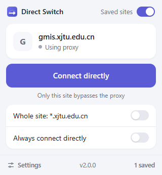
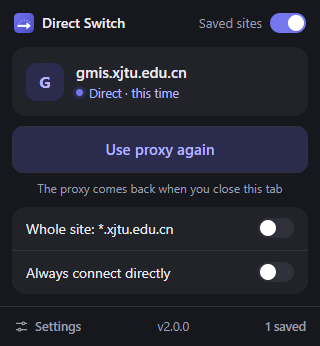
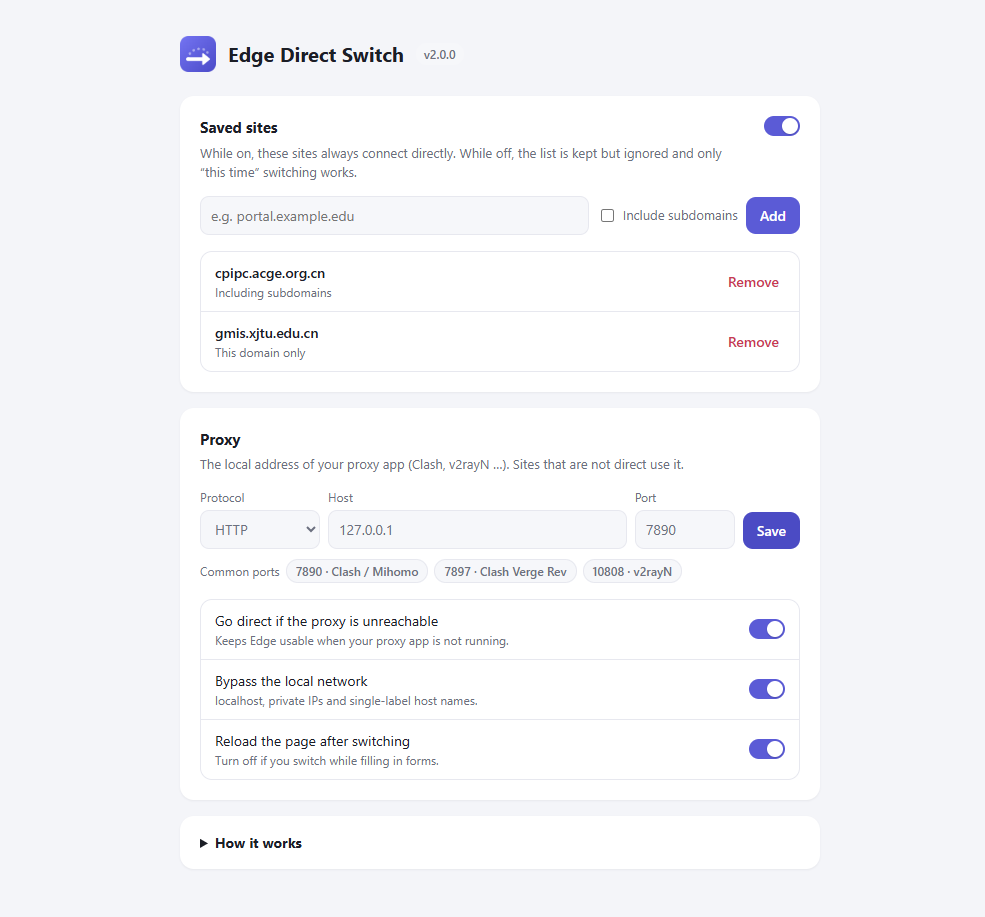

<p align="center"></p>

<h1 align="center">Edge Direct Switch</h1>

<p align="center">Keep your proxy on. When one website won't load through it, connect that site directly with one click.</p>

<p align="center">
  <a href="https://github.com/IdKomorebi/Edge-Direct-Switch/releases/latest">Download</a> ·
  <a href="README.md">简体中文</a> ·
  <a href="docs/TROUBLESHOOTING.md">FAQ</a> ·
  <a href="CHANGELOG.md">Changelog</a>
</p>

<p align="center">
  
  &nbsp;
  
</p>

## Why

Many people keep a local proxy client (Clash, v2rayN …) running all day. Some websites — campus and workplace portals, government services, region-locked video — refuse connections that arrive through the proxy. Instead of switching modes in the proxy client, open this extension and let just that site connect directly.

## Install

Not yet on the Edge Add-ons store:

1. Download `edge-direct-switch-x.y.z.zip` from [Releases](https://github.com/IdKomorebi/Edge-Direct-Switch/releases/latest) and extract it to a folder you will keep.
2. Open `edge://extensions` and turn on **Developer mode**.
3. Click **Load unpacked** and choose the folder containing `manifest.json` (or `extension/` in a source checkout).
4. Pin the extension from the Extensions menu.
5. In Settings, make sure the **proxy port** matches your proxy client. The default is `HTTP 127.0.0.1:7890`; buttons fill in common Clash / Clash Verge / v2rayN ports.

## Use

| Control                                | What it does                                                                            |
| -------------------------------------- | --------------------------------------------------------------------------------------- |
| **Connect directly / Use proxy again** | Switches the current site and reloads it. Ends when you close this tab or restart Edge. |
| **Whole site: \*.example.edu**         | Also includes the site's other subdomains (logins, assets).                             |
| **Always connect directly**            | Adds the site to the **Saved sites** list.                                              |
| **Saved sites** (top right)            | Master switch for the list. When off, the list is kept but ignored.                     |

The UI follows Edge's language (English and Simplified Chinese).

<p align="center"></p>

## How it works

The extension gives Edge a small local PAC script through the [proxy API](https://developer.chrome.com/docs/extensions/reference/api/proxy):

```text
Sites in the direct list       → DIRECT
Local network (optional)       → DIRECT
Everything else                → your proxy port (DIRECT if it is unreachable; optional)
```

- **Resources:** the background worker only wakes for the popup, a tab close or browser start, then sleeps. Edge keeps and evaluates the rules itself.
- **Scope:** only this Edge profile. Windows proxy settings and other apps are untouched. The extension **controls Edge's proxy only while at least one direct rule is active** and hands control back as soon as none are; disabling or removing it does the same.
- **Proxy clients:** keep running as usual. While the extension is in control, other sites are sent to the fixed port in Settings, so it must be correct. Rules inside your client still apply to that traffic.
- **Other proxy extensions:** only one extension can control the proxy. If another one does, a conflict is shown; this extension never fights for control.

## Limits

- Rules are **per domain**, not per tab or per path.
- Browser DIRECT cannot bypass a client running in **TUN / virtual adapter** mode; add a DIRECT rule in the client instead.
- Pages may load logins or video from other domains. Use **Whole site** or add those domains in Settings.
- No separate InPrivate control.

## Permissions and privacy

| Permission  | Purpose                                                   |
| ----------- | --------------------------------------------------------- |
| `proxy`     | Set and release Edge's proxy configuration                |
| `activeTab` | Read the current site's host name when you open the popup |
| `storage`   | Keep settings and saved sites on this device              |

No page access, content scripts, network requests, analytics or sync. See [PRIVACY.md](PRIVACY.md).

## Development

Node.js 20+:

```sh
npm ci
npm test               # unit tests
npm run check          # package layout, permissions, locale completeness
npm run test:browser   # real Edge routing test + documentation screenshots
npm run pack           # build dist/*.zip
```

The browser test uses a throwaway profile and local marker servers only. See [docs/TESTING.md](docs/TESTING.md) and [CONTRIBUTING.md](CONTRIBUTING.md).

## License

[MIT](LICENSE) © [IdKomorebi](https://github.com/IdKomorebi)
