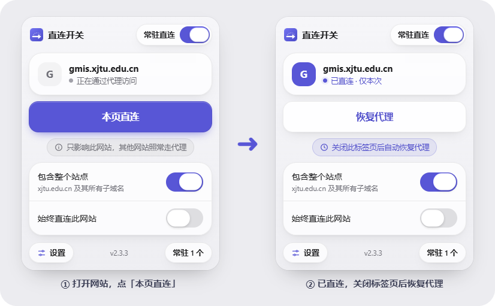
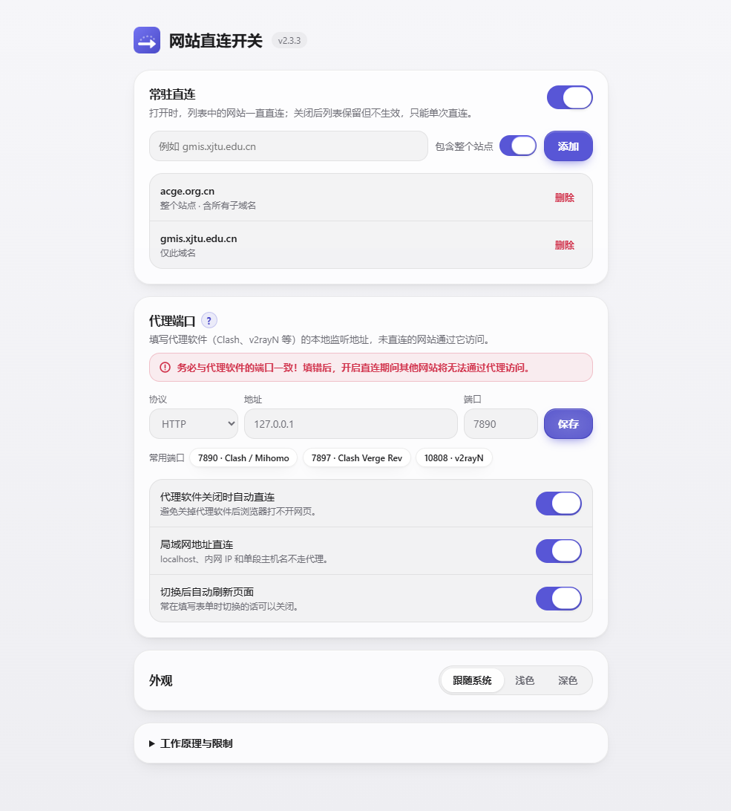
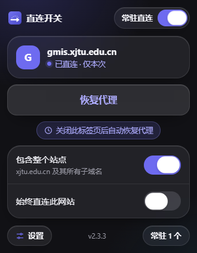

<p align="center"></p>

<h1 align="center">网站直连开关 · Direct Switch</h1>

<p align="center">代理一直开着，某个网站打不开时，点一下让它单独直连。<br>适用于 <b>Microsoft Edge</b> 和 <b>Google Chrome</b>，同一个安装包。</p>

<p align="center">
  <a href="https://github.com/IdKomorebi/Edge-Direct-Switch/releases/latest">下载</a> ·
  <a href="README.en.md">English</a> ·
  <a href="docs/TROUBLESHOOTING.md">常见问题</a> ·
  <a href="CHANGELOG.md">更新记录</a>
</p>

<p align="center">
  <a href="https://github.com/IdKomorebi/Edge-Direct-Switch/actions/workflows/test.yml"></a>
  <a href="https://github.com/IdKomorebi/Edge-Direct-Switch/releases"></a>
  <a href="LICENSE"></a>
</p>

<p align="center"></p>

## 适合谁

为了访问海外服务，代理基本全天开着；但学校/单位系统、政府网站、部分有版权地区限制的视频网站，开着代理反而打不开。每次去代理软件里切换模式或加规则太麻烦——这个扩展让你在浏览器里点一下就解决。

## 安装

Edge 和 Chrome 用**同一个安装包**。尚未上架扩展商店，需要手动加载：

1. 从 [Releases](https://github.com/IdKomorebi/Edge-Direct-Switch/releases/latest) 下载 `direct-switch-x.y.z.zip`，解压到一个**不会删除**的文件夹。
2. 打开扩展管理页并开启开发者模式：
   - **Edge**：地址栏输入 `edge://extensions`，打开左侧「开发人员模式」，点「加载解压缩的扩展」。
   - **Chrome**：地址栏输入 `chrome://extensions`，打开右上角「开发者模式」，点「加载已解压的扩展程序」。
3. 选择解压后包含 `manifest.json` 的文件夹。
4. 在工具栏的扩展菜单里把它固定出来。
5. 打开扩展设置，确认**代理端口**和你的代理软件一致（默认 `HTTP 127.0.0.1:7890`，页面上有 Clash / Clash Verge / v2rayN 的常用端口可一键填入）。

> 从源码安装时，选择仓库里的 `extension/` 文件夹即可。

## 使用

在打不开的网站上点击扩展图标：

| 控件                       | 作用                                                                                                                                  |
| -------------------------- | ------------------------------------------------------------------------------------------------------------------------------------- |
| **本页直连 / 恢复代理**    | 当前网站改为直连并自动刷新。关闭这个标签页或重启浏览器后自动恢复代理。                                                                |
| **包含整个站点**           | **默认开启**，连同同一站点的其他子域名一起直连（很多系统会从 `gmis.` 跳到 `login.` 等子域名）。关闭则只直连当前域名，会记住你的选择。 |
| **始终直连此网站**         | 把网站加入「常驻直连」列表，以后打开就是直连。                                                                                        |
| **常驻直连**（右上角开关） | 整个常驻列表的总开关。关闭后列表保留但不生效，只能单次直连。                                                                          |

开关可以点，也可以拖动；只有开关本身可操作，点文字不会误触。

### 「包含整个站点」是什么意思？

域名从右往左逐级细分。以 `cpipc.acge.org.cn` 为例：`org.cn` 是任何人都能注册的公共后缀，`acge.org.cn` 是某个单位注册的**站点**，`cpipc.`、`www.`、`static.` 等是它下面的子域名。

- 关闭：只直连 `cpipc.acge.org.cn` 这一个域名。
- 打开：直连整个站点 `acge.org.cn` 及其所有子域名。界面上会直接写出实际范围。

弹窗和设置页里的这个选项含义完全相同，设置页输入域名时会实时预览将要添加的范围。站点的判断会识别 `edu.cn`、`org.cn`、`co.uk`、`github.io` 等常见公共后缀，不会扩大到别人的网站。

### 设置页与外观

设置页可以管理常驻网站、查看本次直连、修改代理端口，并选择外观：**跟随系统 / 浅色 / 深色**。

<p align="center">
  
  &nbsp;
  
</p>

## 工作原理与影响范围

扩展通过浏览器的 [proxy API](https://developer.chrome.com/docs/extensions/reference/api/proxy) 写入一段本地 PAC 规则：

```text
在直连列表中的网站      → DIRECT
局域网地址（可关闭）    → DIRECT
其他网站                → 你的代理端口（代理软件没开时自动直连，可关闭）
```

关心的几个问题：

- **什么时候会接管浏览器的代理？** 看的是"有没有生效的直连规则"，而不是"有没有打开这些网站"：

  | 情况                                 | 是否接管                           |
  | ------------------------------------ | ---------------------------------- |
  | 点了「本页直连」                     | 接管，直到那个标签页关闭           |
  | 「常驻直连」开关打开，且列表里有网站 | **一直接管**（即使没打开这些网站） |
  | 「常驻直连」关闭，也没有单次直连     | 不接管，浏览器完全跟随系统代理     |

  规则必须在网页打开**之前**就生效，否则第一个请求已经走代理发出去了，所以常驻列表打开时会一直接管。不需要时关掉右上角的「常驻直连」即可。

- **我只想让某个网站直连，为什么还要填代理端口？** 因为浏览器扩展只能**整体替换**浏览器的代理配置，不能"只改一个网站、其余保持原样"。一旦接管，扩展就必须为所有网站给出答案；而扩展读不到 Windows 系统代理的地址，所以需要你告诉它代理软件的端口，让其他网站照旧走代理。也正因为如此，扩展**只在有直连网站时才接管**，平时完全不碰代理设置。

- **会一直占内存吗？** 不会。扩展只有在你点开弹窗、关闭标签页、浏览器启动时才被唤醒，空闲约 30 秒后自动休眠。规则由浏览器自己保存和执行，判断一次只是几行字符串比较。
- **会破坏全局代理吗？** 不会。只影响当前浏览器的配置文件，不修改 Windows 系统代理，其他软件不受影响。并且**只有存在生效的直连网站时才接管浏览器的代理**；全部恢复后会立即交还控制权，浏览器回到跟随系统代理。禁用或卸载扩展也会自动交还。
- **和代理软件冲突吗？** 不冲突，代理软件照常运行。接管期间，非直连网站会发往设置里填写的固定端口——所以**端口要填对**；代理软件里原有的分流规则仍然对这些流量生效。
- **和其他代理扩展冲突吗？** 浏览器同一时间只允许一个扩展控制代理。如果 ZeroOmega 等扩展正在控制，本扩展会提示冲突，不会和它抢。

## 实测：接管后会不会让走代理的网站变慢？

不会。`npm run bench` 在真实浏览器里对比了三种配置，目标是本机模拟的 HTTPS 网站，经过一个可以注入延迟和故障的本地代理（详见 [测试说明](docs/TESTING.md)）：

| 场景（每组 120–200 个请求）         | 没有扩展（系统代理） | 扩展接管 · 兜底开 | 扩展接管 · 兜底关 |
| ----------------------------------- | -------------------- | ----------------- | ----------------- |
| 代理稳定：新连接 / 复用连接中位延迟 | 15 / 2 ms            | 16 / 2 ms         | 15 / 2 ms         |
| 代理延迟抖动 20–150 ms：中位 / p95  | 93–108 / 156 ms      | 93–108 / 156 ms   | 94–109 / 156 ms   |
| 10% 的连接被重置：失败率            | 9–14%                | 6–11%             | 6–14%             |
| 节点出错时被改成直连的请求          | 0                    | 0                 | 0                 |
| 代理软件完全关闭                    | 全部失败             | 全部改为直连      | 全部失败          |

- 延迟差异在测量误差之内（93 与 108 ms 相差的正是 Windows 计时器的 15.6 ms 精度）。
- 节点抖动、返回 502、连接中途断开时，**兜底不会触发**，海外网站不会被误切到直连；只有代理端口完全连不上时才会改走直连。

## 已知限制

- **按域名生效**，不是按标签页：同一网站的其他标签页也会直连。网页的具体路径（如 `/pyxx/`）无法单独匹配。
- **TUN / 虚拟网卡模式**下，浏览器直连无法绕过代理软件，需要在代理软件里给该域名加直连规则。
- 网页的登录、视频等资源可能来自其他域名。只有部分内容加载失败时，打开「包含整个站点」或在设置页手动添加相关域名。
- 不支持 InPrivate / 无痕窗口单独控制。

更多排查方法见 [常见问题](docs/TROUBLESHOOTING.md)。

## 权限与隐私

| 权限        | 用途                             |
| ----------- | -------------------------------- |
| `proxy`     | 设置和交还浏览器的代理配置       |
| `activeTab` | 点击扩展图标时读取当前网站的域名 |
| `storage`   | 在本机保存设置和常驻网站列表     |

不读取网页内容，没有内容脚本，不联网、不统计、不同步。详见 [PRIVACY.md](PRIVACY.md)。

## 开发

需要 Node.js 20+：

```sh
npm ci
npm test               # 单元测试
npm run check          # 打包结构、权限、中英文文案完整性
npm run test:browser   # 真实浏览器路由测试（默认 Edge），同时生成文档截图
npm run pack           # 打包到 dist/
```

浏览器测试使用独立的临时配置文件和本机测试服务器，不访问外部网站，也不影响你日常使用的浏览器。CI 会在 Edge 和 Chromium（Chrome 的开源内核）上各跑一遍。详见 [docs/TESTING.md](docs/TESTING.md)。欢迎提 Issue 和 PR，请先阅读 [CONTRIBUTING.md](CONTRIBUTING.md)。

## License

[MIT](LICENSE) © [IdKomorebi](https://github.com/IdKomorebi)
