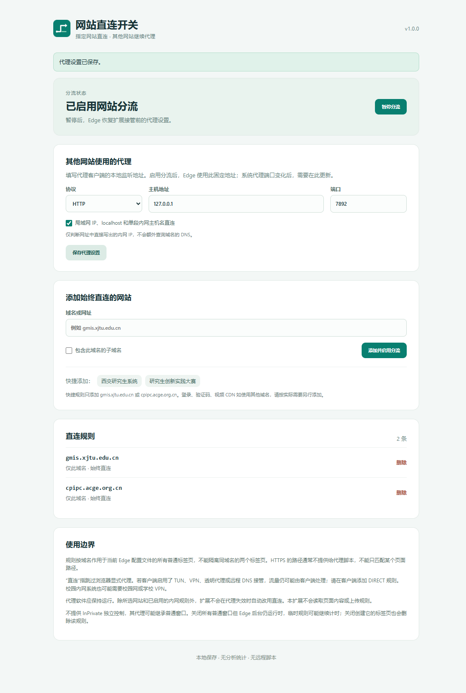

# Edge Direct Switch · 网站直连开关

[English](README.md) · [下载安装包](https://github.com/IdKomorebi/Edge-Direct-Switch/releases/latest) · [安装与排障](docs/TROUBLESHOOTING.md) · [参与贡献](CONTRIBUTING.md)

[](https://github.com/IdKomorebi/Edge-Direct-Switch/actions/workflows/test.yml)
[](https://github.com/IdKomorebi/Edge-Direct-Switch/releases)
[](LICENSE)

在 Edge 工具栏点击一次，让当前网站临时或始终直连；其他网站继续使用本地代理客户端。Manifest V3，无运行时依赖，无远程脚本，无分析统计。

**规则按域名生效，影响同一 Edge 配置文件中该域名的所有普通标签页。它不能让相同网址的两个标签页分别直连和代理。**

## 安装

本扩展通过 GitHub 发布，**尚未上架 Edge 扩展商店**。推荐从 [Releases](https://github.com/IdKomorebi/Edge-Direct-Switch/releases/latest) 下载扩展 ZIP。

1. 下载本仓库，或下载打包后的扩展 ZIP 并解压。
2. 在 Edge 地址栏打开 `edge://extensions`，启用“开发人员模式”。
3. 点击“加载解压缩的扩展”，选择包含 `manifest.json` 的 **extension** 文件夹。若使用扩展 ZIP，选择解压后直接包含 `manifest.json` 的目录。
4. 在工具栏“扩展”菜单固定“网站直连开关”。
5. 打开扩展设置，确认本地代理协议、地址和端口。默认示例是 **HTTP / 127.0.0.1 / 7892**，必须与自己的代理客户端一致。

加载后默认跟随原有代理设置。首次添加直连规则，或点击“启用分流”，才会接管当前 Edge 配置文件的代理设置。

## 使用

- 打开无法访问的网站，点击扩展，选“临时直连 30 分钟”或“始终直连此网站”。
- 默认仅匹配当前主机。需要时勾选“包含此域名的子域名”，不会自动扩大到上级域名。
- 默认会刷新当前页面；正在填写表单时，先取消“操作后刷新当前页”。
- 临时规则在 30 分钟后或创建它的标签页关闭时删除，跨完整浏览器重启也会清除。浏览器休眠会推迟清理，唤醒后重新处理。
- “删除此直连规则”删除当前命中的规则。若仍有其他重叠规则，该网站可能继续直连，可到设置中检查。
- “暂停分流”释放扩展的代理设置，恢复较低优先级的设置，通常是 Windows 系统代理；规则仍保留。禁用或卸载扩展也会释放控制。

设置页有两个可选快捷规则：`gmis.xjtu.edu.cn`、`cpipc.acge.org.cn`。它们仅在你点击后添加。没有预设所有政府、单位、教育或视频域名。



_截图来自真实 Edge 扩展设置页，使用示例规则；路由测试使用本地测试服务，不代表已验证这些外部网站的可达性。_

## 工作原理与限制

扩展生成一个本地 PAC 脚本：

```text
命中直连规则              → DIRECT
内网 IP / localhost      → DIRECT（可关闭）
其他请求                 → 用户指定的 HTTP / HTTPS / SOCKS5 代理
```

- 扩展只改变 Edge 的代理配置，不修改 Windows 系统代理。其他应用继续使用原来的设置。
- 启用分流后，其他网站使用设置页的**固定代理端点**，不会动态继承 Windows 的 PAC、自动检测或客户端端口变化。客户端已有的域名分流仍可在该端点内部生效。若原来使用复杂 PAC，请优先在客户端增加直连规则。
- HTTPS 的 URL 路径和查询通常不会传给 PAC；因此无法可靠地只处理 `/pyxx/` 或某个标签页。PAC 没有标签页 ID。
- “DIRECT”只跳过浏览器显式代理。TUN、VPN、透明代理和 DNS 接管仍可能接管流量。此时应在代理客户端中添加 DIRECT 规则。校园内网系统可能还需要校园网或学校 VPN。
- 登录、验证码、接口、图片和视频 CDN 常使用额外域名。当前网站直连后若仍有部分内容失败，需按实际域名添加规则；不要盲目将公共 CDN 全部直连。
- 内网判断仅作用于网址直接写出的 IP、localhost 和单段主机名，不对任意域名额外执行 DNS 查询。
- 不提供 InPrivate 独立控制；浏览器的代理配置有继承规则，InPrivate 可能继承普通窗口代理。请在普通窗口使用本扩展。
- 已建立的长连接和缓存可能继续存在；切换后请刷新受影响页面。改变规则不会撤销已发出的请求。
- 代理端点失效时，普通网站不会自动退回直连。此时应修复端口或暂停扩展。
- 若代理设置被组织策略或其他扩展控制，本扩展会显示冲突，不会循环抢占控制。请一次只启用一个代理管理扩展。

## 现有方案

无需使用本扩展也可以完成类似目标：

1. [ZeroOmega 官方仓库](https://github.com/zero-peak/ZeroOmega) / [Edge 商店](https://microsoftedge.microsoft.com/addons/detail/zeroomegaproxy-switchy-/dmaldhchmoafliphkijbfhaomcgglmgd)：配置自动切换，目标域名选择直连，默认规则选择本地代理。
2. **代理客户端规则模式**：给目标域名添加 DIRECT，是同时兼容 TUN 和多个应用的优先方案。具体写法取决于客户端。
3. **独立直连浏览器配置文件或浏览器**：适合需要更强隔离的场景，但系统级 VPN/TUN 仍需客户端配合。

## 权限与隐私

| 权限        | 用途                                   |
| ----------- | -------------------------------------- |
| `proxy`     | 设置或释放当前 Edge 配置文件的代理规则 |
| `activeTab` | 用户点击扩展时取得当前页的网址         |
| `storage`   | 在本机保存设置和明确添加的域名规则     |
| `alarms`    | 到期清理临时规则                       |

没有 `<all_urls>`、`tabs`、`webRequest`、内容脚本或外部连接入口；不会读取页面正文、表单、密码、Cookie 或浏览历史。域名规则保存在本地，不使用云同步。详见 [PRIVACY.md](PRIVACY.md)。

## 开发与验证

需要 Node.js 20+，不需要 `npm install`：

```sh
npm test
npm ci
npm run format:check
npm run test:browser
npm run pack
```

ZIP 输出到 `dist/`，只包含扩展运行文件，`manifest.json` 在 ZIP 根目录。打包过程不包含测试数据、浏览器配置文件或 Git 历史。CI 在 push 和 PR 时运行测试并生成可下载的扩展包。

可选浏览器测试：先在仓库外安装 Playwright 和 Edge，再运行 `node scripts/browser-smoke.mjs`。也可用环境变量 `PLAYWRIGHT_MODULE` 指定已有 Playwright 模块的绝对目录，`TEST_BROWSER=chromium` 选择 Playwright Chromium。脚本使用独立临时配置文件和本地测试代理，检查真实 DIRECT/PROXY 路由、临时规则和暂停恢复，不操作日常浏览器配置文件。

`npm ci` 安装格式工具及浏览器测试驱动；扩展运行文件不包含这些依赖。2026-10-25 已在 **Windows + Edge 155.0.4283.45** 上通过真实路由测试，验证目标域名直连、其他域名代理、删除规则、临时规则标签页关闭清理及暂停恢复。没有测试所有外部网站、TUN/VPN 组合或真实 SOCKS5 服务。详见 [测试说明](docs/TESTING.md)。

欢迎提交问题、翻译和小范围改进，先阅读 [贡献指南](CONTRIBUTING.md)、[安全报告](SECURITY.md) 和 [更新记录](CHANGELOG.md)。

## API 依据

- [Microsoft Edge 支持的扩展 API](https://learn.microsoft.com/en-us/microsoft-edge/extensions/developer-guide/api-support)
- [Chromium 代理行为、PAC 参数和 HTTPS URL 清理](https://chromium.googlesource.com/chromium/src/+/HEAD/net/docs/proxy.md)
- [Chrome proxy API](https://developer.chrome.com/docs/extensions/reference/api/proxy)
- [设置作用域、生命周期和优先级](https://developer.chrome.com/docs/extensions/reference/api/types)
- [Edge 本地加载扩展](https://learn.microsoft.com/en-us/microsoft-edge/extensions/getting-started/extension-sideloading)

## License

MIT
